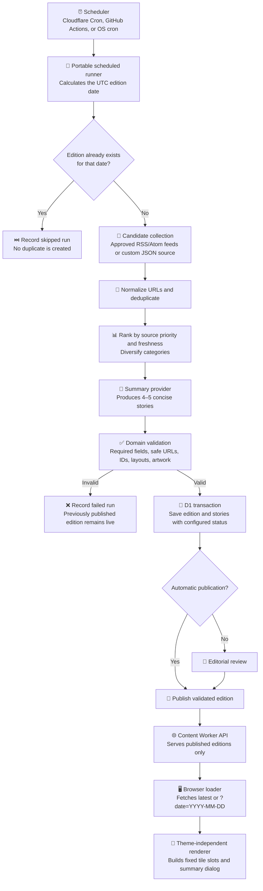

# Content Engine

This guide describes the complete path from approved AI-news sources to the fixed story tiles on the AI Nuggets homepage. It covers daily generation, review and publication, public delivery, and browser rendering.

## What the content engine owns

The content engine keeps editorial content separate from visual themes:

- gathers source candidates and creates a daily edition;
- validates and stores the edition in the content database;
- exposes **published** editions through a public API;
- loads an edition in the browser and renders stable story-tile markup.

Themes only control presentation. They do not fetch or transform editorial data.

## End-to-end flow



## Components and responsibilities

| Area | Location | Responsibility |
|---|---|---|
| Public API configuration | `content-engine/config.js` | Defines the browser-visible Worker base URL. |
| Browser loader | `content-engine/loader.js` | Validates an optional preview date, requests an edition, and rejects malformed API payloads. |
| Browser renderer | `content-engine/render.js` | Creates semantic tile buttons, stable slot classes, and the summary dialog behavior. |
| Central configuration | `content-engine/content-engine.config.mjs` | Human-editable UTC schedule, publication mode, and approved feeds. |
| Daily automation | `content-engine/automation/` | Portable source collection, summary generation, validation, idempotency, and audit orchestration. |
| Worker adapter | `infra/cloudflare/content-worker/src/` | Connects the portable automation to Cron, D1, secrets, and public HTTP routes. |
| Content database | Cloudflare D1 `ai-nuggets-content` | Source of truth for editions, stories, and generation audit records. |
| Theme | `themes/<theme-id>/` | Styles the stable markup; never fetches or changes content. |

## Daily edition lifecycle

### 1. Schedule and editorial date

The scheduler calls the portable runner. The central configuration supplies the UTC Cron expression, and the deployment script derives the Cloudflare Cron trigger from it. The runner computes the edition `YYYY-MM-DD` date in UTC rather than relying on a server's local clock.

### 2. Idempotency and auditing

Before collection, the job asks the repository whether an edition already exists for the target date. If it does, the job records a `skipped` run and exits without overwriting editorial content. Each attempt is audited as `started`, `skipped`, `succeeded`, or `failed`.

### 3. Candidate collection

By default, the built-in collector reads the editable approved feed list in `content-engine/content-engine.config.mjs`:

1. Fetch up to three recent posts from each RSS or Atom feed.
2. Remove tracking parameters and normalize candidate URLs.
3. Drop duplicate links.
4. Rank candidates using configured source priority and recency.
5. Prefer category diversity, then fill the remaining positions by rank.

An optional HTTPS JSON candidate endpoint can replace the built-in collector. Feed and custom-source requests are bounded by timeouts. A single unavailable feed does not cancel the run; a run fails only if no usable source candidates remain.

### 4. Summarization and selection

An OpenAI-compatible summary provider receives the ranked candidates and returns a structured edition containing four or five stories. Each story has a Quick take, Full context, and Deep dive summary rather than stored raw source article text. Provider settings are supplied at runtime; API keys never belong in browser assets, logs, or Git.

### 5. Validation

The domain layer rejects an edition unless it has:

- the requested editorial date;
- exactly four or five stories;
- unique story IDs and ordered positions;
- required category, title, all three summary contexts within their configured minimum and maximum lengths, destination, and artwork fields;
- HTTPS story and source URLs where URLs are present;
- supported artwork keys: `models`, `agents`, `research`, `product`, or `business`;
- exactly one `lead` story and no more than one `wide` story;
- briefing copy constrained to fit the fixed bento layout.

Validation happens before persistence. A malformed provider response cannot replace the currently published edition.

### 6. Persistence and publication

A valid edition and all of its stories are written together in one D1 transaction. By default, `publication.automaticallyPublish` is `true`, so validated editions are published immediately. Set it to `false` when an editor must review and publish each edition.

If any step fails, the run is marked `failed`; the last valid published edition remains available to readers.

## Data model

| Table | Key fields | Purpose |
|---|---|---|
| `editions` | `edition_date`, `status`, briefing fields, `published_at` | One daily briefing. Status is `draft`, `published`, or `archived`. |
| `stories` | `edition_id`, `position`, `layout`, title, three summary layers, source metadata | Four or five ordered stories for an edition. |
| `generation_runs` | `target_date`, `status`, timestamps, details | Immutable operational history for each automation attempt. |

The `stories` table enforces unique positions and story keys per edition. The database schema and migrations are under `infra/cloudflare/content-worker/migrations/`.

## Publication and public delivery

The Worker exposes only published content:

| Route | Behavior |
|---|---|
| `GET /health` | Returns Worker availability. |
| `GET /api/editions/latest` | Returns the newest published edition on or before today's editorial date. |
| `GET /api/editions/YYYY-MM-DD` | Returns the newest published edition on or before the requested date. |
| `POST /internal/generate` | Authenticated operational endpoint that runs generation for a supplied or current target date. It is not a public browser endpoint. |

The API returns a single edition object with briefing metadata and ordered stories. Responses are edge-cacheable and browser access is restricted to configured allowed origins. Draft and archived editions never appear in public API responses.

## Browser rendering path

1. `content-engine/loader.js` reads `?date=YYYY-MM-DD`, when provided, and validates the date.
2. It requests `/api/editions/latest` or the date-specific route from the Worker URL in `content-engine/config.js`.
3. It verifies the returned briefing and four-to-five-story payload before exposing it as `window.AINuggetsContentReady`.
4. `content-engine/render.js` creates one accessible button per story and assigns deterministic slot classes such as `story-card--slot-1` through `story-card--slot-5`.
5. The active theme uses those stable classes to place the cards. Selecting a tile opens a compact dialog on the Full context summary. Readers can switch to Quick take or Deep dive using the accessible in-dialog controls; all three persisted layers are already in the API response, so switching does not make another request.

The rendering layer is intentionally theme-independent, so a theme switch can restyle the same content without changing its data contract or interaction behavior.

## Operational safeguards

- The portable automation core does not import Cloudflare or D1 code; cloud-specific code is a runtime adapter.
- Source material is untrusted input. The system never executes instructions found in articles or feeds.
- Raw copyrighted article text is not stored; the product stores original summaries and source attribution.
- Missing model configuration produces a safe skipped run rather than fabricated content.
- Partial provider configuration is rejected with the missing setting names.
- Publication is configured centrally: automatic publication is enabled by default, while review mode saves drafts for editorial approval.
- Failure leaves the last published edition available.

## Central configuration

Edit `content-engine/content-engine.config.mjs` to control the following non-secret settings in one place:

| Setting | Purpose | Change effect |
|---|---|---|
| `schedule.cron` | Daily Cron expression in UTC, using Cloudflare's five-field syntax. The default `0 12 * * *` runs at 12:00 UTC. | Worker deployment applies the new trigger. |
| `publication.automaticallyPublish` | `true` publishes validated editions immediately; `false` saves them as drafts. | Worker deployment changes future generation only. |
| `summaries.defaultContext` | Default popup summary layer. The default is `standard` (Full context). | Browser and Worker deployments use the configured contract. |
| `summaries.contexts` | Labels plus minimum and maximum character limits for `compact`, `standard`, and `detailed` summaries. The defaults are 100-180, 240-420, and 500-900 respectively. | Worker deployment applies the generated-summary limits. |
| `feeds` | Approved RSS/Atom sources with `name`, HTTPS `feedUrl`, `category`, and numeric `priority`. | Worker deployment applies additions, removals, and edits. |

After editing this file, deploy the content Worker so its Cron trigger and runtime adapter receive the updated configuration:

```powershell
.\infra\cloudflare\content-worker\deploy.ps1
```

`automaticallyPublish` is `true` by default. Set it to `false` when editorial review is required. Feed changes apply only when `CONTENT_SOURCE_URL` is not configured; that optional runtime setting replaces the built-in feed collector with a custom JSON source.

## Related documentation

- [Daily content automation](DAILY_CONTENT_AUTOMATION.md): provider configuration, scheduler adapters, local testing, and deployment details.
- [Viewing the D1 database](VIEW_D1_DATABASE.md): dashboard and Wrangler queries for editions, stories, and runs.
- [Content Engine API](CONTENT_ENGINE_API.md): quick directory-level API and ownership reference.
