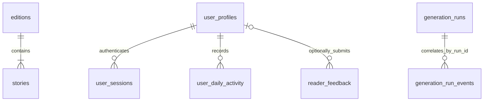

# Cloudflare D1 Schema Reference

This document is the authoritative reference for every application table in the AI Nuggets Cloudflare D1 database. It explains the **what, why, where, and how** for each table, including ownership, relationships, access boundaries, retention, and privacy.

> **Maintenance rule:** Any change to D1 tables, columns, constraints, indexes, relationships, retention, or table access behavior must include an update to this document in the same change. Apply schema changes only through a new ordered migration in `infra/cloudflare/content-worker/migrations/`; never edit an applied migration.

> **Query timestamp rule:** D1 stores timestamps in UTC. Every repository-documented query and every rendered query result that includes a date-time must convert it to explicitly labeled Indian Standard Time (`IST`, UTC+05:30) for readability. Keep raw UTC values only where they are needed for filtering or ordering; never present an unlabeled UTC timestamp as reader-facing output.

## Scope and access boundary

D1 is the system of record for published editorial data, authenticated-reader data, reader feedback, and content-generation operations. The Cloudflare content Worker accesses it through the `CONTENT_DB` binding. Browser code never connects to D1 directly. Beta and production use separate databases, so any query or migration affects only the selected environment.

| Table | What it stores | Why it exists | Primary access path | Retention / sensitivity |
|---|---|---|---|---|
| `editions` | One dated briefing and publication state | Durable parent of a daily briefing; prevents duplicate edition dates | Generation repository writes; public Worker API reads published rows | Editorial data; retained until deliberately changed or removed |
| `stories` | Four or five ordered stories for an edition | Separates reader-ready stories and attribution from shared briefing copy | Generation repository writes; public Worker API reads through `editions` | Editorial; public only with a published parent |
| `generation_runs` | One parent record per generation attempt | Provides lifecycle status, target date, and a stable investigation `runId` | Automation writes; protected internal API and operators read | Completed rows purged after three days |
| `generation_run_events` | Ordered safe decision events within one run | Gives a detailed stage-by-stage investigation timeline | Automation writes; protected internal API and operators read | Purged with its completed parent after three days |
| `user_profiles` | Verified Google identity and reader activity/streak state | Provides durable identity and server-authoritative streaks | Authentication and authenticated edition requests write | Private personal data |
| `user_sessions` | Hashes of opaque session tokens and expiry times | Restores and revokes sign-in without storing usable tokens | Authentication creates; authorization reads; sign-out deletes | Security-sensitive hash; expires after 30 days |
| `user_daily_activity` | One qualifying UTC activity day per reader | Makes streak calculation idempotent and auditable | Authentication and authenticated edition requests write | Private activity history |
| `reader_feedback` | Reader email, rating, optional linked profile, and message | Preserves feedback for editorial and product review | Feedback endpoint writes; authorized operators query | Private contact data and free text |

## Relationships

`stories`, `user_sessions`, and `user_daily_activity` use database foreign keys to their parent tables. `reader_feedback.user_id` is optional: anonymous readers may submit feedback, and deleting a profile retains feedback while setting its link to `NULL`. `generation_run_events` correlates to `generation_runs` by the unique UUID `run_id`, rather than a foreign key to an internal numeric ID, so the portable automation contract does not depend on a provider-specific identifier.

## Editorial tables

### `editions`

**What:** One row for each editorial date (`edition_date`, `YYYY-MM-DD`). It stores the common briefing copy (`eyebrow`, `title`, `emphasis`, `summary`, `meta_json`), publication `status` (`draft`, `published`, or `archived`), and lifecycle timestamps.

**Why:** It is the parent and publication boundary for every briefing. Its unique edition date prevents duplicates. The public API returns only `published` rows, keeping drafts and archived material out of the reader experience.

**Where:** `content-engine/automation/` creates the portable edition object; `infra/cloudflare/content-worker/src/d1-edition-repository.js` persists it. `infra/cloudflare/content-worker/src/index.js` reads it for `GET /api/editions/latest` and `GET /api/editions/YYYY-MM-DD`.

**How:** A successful run inserts the edition and its stories in one D1 batch. The repository sets `published_at` only when automatic publication is configured; otherwise it saves a draft. The API selects the latest published edition on or before the requested date. Deleting an edition cascades to its stories. A `(status, edition_date DESC)` index supports the public lookup.

### `stories`

**What:** One reader-facing story card belonging to an edition. It has `story_key`, `position` (1–5), optional `layout` (`lead` or `wide`), category, title, destination URL, artwork key, source attribution, and summary variants: `summary_compact`, `summary` (Overview), and `summary_detailed`.

**Why:** Separating stories from their shared briefing lets the system order, validate, render, attribute, and summarize each item independently. Stored variants allow readers to change summary depth without another model request.

**Where:** Rows belong to `editions.id` through `edition_id`. The D1 repository writes validated generation output; the Worker retrieves ordered rows only after selecting a published parent edition.

**How:** The content engine validates exactly four or five stories before persistence. D1 enforces unique `(edition_id, story_key)` and `(edition_id, position)` values. The Worker reads in ascending position order. `position` is constrained to 1–5; the `(edition_id, position)` index supports retrieval; a parent deletion cascades to child rows.

## Generation investigation tables

### `generation_runs`

**What:** One lifecycle record for every manual or scheduled generation attempt. It stores UUID `run_id`, `target_date`, terminal-capable `status` (`started`, `skipped`, `succeeded`, `failed`), concise `details`, and start/finish timestamps.

**Why:** It supplies a stable correlation key and explains skipped, failed, and successful runs. A run is recorded even when an edition already exists or required automation configuration is absent.

**Where:** The portable generation job uses a repository contract; the D1 adapter creates and finalizes the row. Manual `POST /internal/generate` returns its `runId`; beta-only `dryRun: true` requests can create a successful investigation row without changing editorial tables. Protected `GET /internal/generation-runs/:runId` returns the parent run with its detailed events. It is never returned from public reader endpoints.

**How:** Each attempt first removes expired completed investigation data, creates one `started` row, then updates that same row with terminal status and `finished_at`. `run_id` has a unique partial index. Historical runs created before migration `0011` may have a `NULL` `run_id` and cannot be investigated through the new UUID timeline.

**Retention:** Completed rows become eligible after three days. Active rows without `finished_at` are never deleted. Cleanup runs at the beginning of a later generation attempt, so records can remain beyond three days if no further attempt occurs.

### `generation_run_events`

**What:** An ordered safe event inside a `run_id`: `sequence`, `stage`, `event_name`, `outcome` (`info`, `succeeded`, `skipped`, or `failed`), optional `duration_ms`, JSON metadata, and timestamp.

**Why:** It provides precise evidence of eligibility, source collection, candidate selection, summary-provider metadata, validation, persistence, and terminal decisions instead of only a final status. A beta dry run records its explicit existing-edition bypass and persistence suppression, so it cannot be mistaken for a saved edition.

**Where:** Events originate in the injected portable logger at `content-engine/automation/pipeline/generation-event-logger.mjs`; `d1-edition-repository.js` stores them. Operators read them through the protected internal endpoint or the unified query in [Viewing the D1 Database](VIEW_D1_DATABASE.md#unified-detailed-view-for-one-generation-run).

**How:** The logger serializes concurrent writes. D1 assigns a per-run sequence and enforces unique `(run_id, sequence)`; the `(run_id, sequence ASC)` index supports ordered timelines. Retention cleanup deletes event rows before their parent runs.

**Privacy:** Metadata excludes credentials, authorization headers, raw feeds/articles, complete prompts, and raw model responses. Error messages are capped. This is an operational timeline, not a content archive.

## Reader identity and activity tables

### `user_profiles`

**What:** One verified Google identity with unique `google_subject`, current verified email, display name, optional picture URL, lifecycle timestamps, login/refresh timestamps, and current/longest streak state.

**Why:** The Google subject remains stable when email or display name changes. Server-side activity and streak fields prevent browser-controlled streaks while supplying the authenticated-reader response.

**Where:** The Worker writes it after credential verification in `POST /auth/google`. Authenticated published-edition requests update refresh activity and may qualify for a streak. Session lookups join this table for `GET /auth/session` and authenticated edition responses.

**How:** Sign-in upserts by `google_subject`, refreshing trusted identity fields. The Worker derives dates from its UTC clock and updates streak values using `user_daily_activity`. Deleting a profile cascades to sessions and daily activity; linked feedback remains but loses its optional profile reference.

**Privacy:** Email, name, picture URL, and activity timestamps are personal data. They are never returned by public edition endpoints.

### `user_sessions`

**What:** A profile link, SHA-256 `token_hash`, Unix `expires_at`, and creation timestamp for one opaque session.

**Why:** A database row cannot be replayed as a browser credential because it contains only a hash. It enables session restoration, expiry checks, and single-session revocation through sign-out.

**Where:** `POST /auth/google` creates a row. `GET /auth/session` and authenticated edition requests read it by hash and expiry. `POST /auth/sign-out` deletes the matching row. The browser holds only the opaque token in local storage.

**How:** The Worker hashes every presented bearer token before querying, requires `expires_at` to be in the future, and creates sessions with a 30-day lifetime. `token_hash` is unique; `(token_hash, expires_at)` is indexed; profile deletion cascades to sessions.

### `user_daily_activity`

**What:** One qualifying activity date per profile: `user_id`, UTC `activity_date`, and `recorded_at`. `(user_id, activity_date)` is its composite primary key.

**Why:** It is the durable evidence behind streak state. It prevents duplicate tabs, retries, and refreshes from incrementing a streak more than once and provides a support-friendly activity history.

**Where:** The Worker writes it after verified sign-in and authenticated published-edition requests. [Daily Streak](DAILY_STREAK.md) documents the reader rules and operational queries.

**How:** The Worker calculates today and yesterday from its UTC clock, inserts with `ON CONFLICT(user_id, activity_date) DO NOTHING`, then conditionally updates the profile streak fields in the same D1 batch. Profile deletion cascades to activity rows.

## Reader feedback table

### `reader_feedback`

**What:** A feedback submission: optional authenticated `user_id`, email address, `rating_halves`, message, and `created_at`. Signed-in readers use their verified profile email; anonymous readers provide an email.

**Why:** Feedback must remain available for editorial and product review whether or not the reader has an account. The optional link adds context without requiring sign-in.

**Where:** `POST /api/feedback` validates and inserts the row. There is intentionally no public feedback-read endpoint; authorized operators query D1 directly.

**How:** The Worker normalizes and validates email, accepts whole-star ratings as 2, 4, 6, 8, or 10 half-star units, and accepts 20–4,000 character messages. D1 independently constrains ratings to 1–10 and message length to 20–4,000 characters. `created_at` and `user_id` indexes support review. Profile deletion sets `user_id` to `NULL` while retaining feedback.

**Privacy:** Feedback contains contact data and unstructured reader text. Never expose it publicly, add it to generation logs, or include it in beta editorial syncs.
