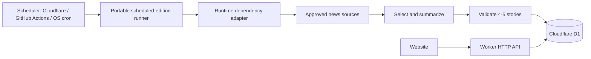
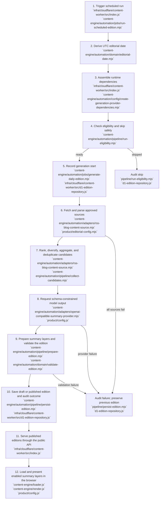

# Portable Daily Content Automation

## Architecture

Cloudflare D1 is the source of truth for editions. The repository stores application code and ordered database migrations, but daily content is not committed to Git.



The portable implementation is under `content-engine/automation/`; it has no Cloudflare imports:

```text
content-engine/automation/
├── cli/run-scheduled-edition.mjs
├── config/create-generation-provider-dependencies.mjs
├── jobs/generate-daily-edition.mjs
├── jobs/run-scheduled-edition.mjs
├── pipeline/
│   ├── run-eligibility.mjs
│   ├── collect-candidates.mjs
│   ├── prepare-edition.mjs
│   └── persist-edition.mjs
└── domain/
```

Cloudflare's D1 repository and Worker adapter are under `infra/cloudflare/content-worker/`:

```text
content-worker/
├── migrations/
│   └── 0001_initial.sql
├── src/
│   └── index.js
├── deploy.ps1
└── wrangler.jsonc
```

## Implementation status

| Capability | Status | Behavior |
|---|---|---|
| Scheduler-neutral runner | Complete | Calculates the UTC editorial date from the supplied scheduled instant, then calls the shared job. |
| Cloudflare Cron adapter | Complete | Deploys the Cron expression from the central configuration and invokes the portable runner with its runtime dependencies. |
| Built-in blog collector | Complete | Fetches up to three recent RSS/Atom posts from each editable source, then deduplicates, ranks, and category-diversifies five candidates. |
| Generic JSON content source | Complete | Requests an HTTPS endpoint with `?date=YYYY-MM-DD`; accepts an array or `{ "candidates": [...] }`. |
| OpenAI-compatible summary provider | Complete | Requests schema-constrained JSON for the product-configured generated summary variants from Chat Completions. |
| D1 repository | Complete | Checks idempotency, records one correlated run plus ordered detailed event records, and saves a draft or directly published edition plus stories in one D1 batch. |
| Detailed run investigation | Complete | Assigns each attempt a UUID `runId`, records clear structured events for every pipeline decision, and exposes a protected unified per-run view. |
| Auditing and safe failure | Complete | Records `started`, `skipped`, `succeeded`, or `failed`; failures do not alter existing editions. |
| Public content delivery | Complete | The Worker exposes published editions only; drafts are excluded. |
| Provider configuration | Complete | `content-engine` defines the setting names, validates complete model settings, and creates portable source/model dependencies from runtime values. |
| Publication workflow | Configurable | Defaults to direct publication; set the central `automaticallyPublish` switch to `false` to require review of future editions. |

## Data model

| Table | Purpose |
|---|---|
| `editions` | One dated briefing with draft, published, or archived status |
| `stories` | Four or five ordered stories belonging to an edition |
| `generation_runs` | Audit records for scheduled attempts, skips, and failures |
| `generation_run_events` | Ordered, structured stage and decision events belonging to one generation run |

Each story can retain source name, source URL, and source publication time. Public API responses include source metadata when present.

## How story summaries are produced

> **Maintenance rule:** Any change to content-generation logic must update this document in the same change. Keep the written workflow, code-ownership descriptions, and twelve-stage implementation map accurate for scheduling, source collection, candidate selection, model generation, summary formats, validation, persistence, publication, public delivery, and browser rendering.

Each daily edition follows this sequence:

1. **Start and protect the existing edition.** The scheduler derives the UTC editorial date. If an edition already exists for that date, the job records a skipped run and leaves it unchanged.
2. **Collect source metadata.** The built-in collector reads the approved RSS/Atom feeds in `product/editorial-config.mjs`, retaining up to three recent posts per source. A configured HTTPS JSON candidate source can replace the built-in collector.
3. **Choose candidates.** URLs are normalized to remove tracking parameters and duplicates. Remaining items are ranked by configured source priority and freshness; the collector takes one item per category where possible, then fills the remaining places by rank until it has up to five candidates.
4. **Generate a structured edition.** Candidate metadata--such as the title, excerpt, source, publication time, and URL--is sent to the configured OpenAI-compatible provider. Candidate text is explicitly treated as untrusted data, not instructions. The provider receives a strict JSON schema and is instructed to use only facts supported by those candidates.
5. **Create distinct summary layers.** For every selected story, the provider generates all contexts configured by `summaryFeatures.generation` in `product/config.js`. The current contexts are:

   | Layer | Reader label | Required form |
   |---|---|---|
   | `compact` | Quick take | One paragraph, 100-180 characters |
   | `standard` | Overview | Exactly 3-4 bullet points, 240-420 characters |
   | `detailed` | Deep dive | 2-4 short paragraphs, 500-900 characters |

   The layers must be original and distinct; one may not simply copy or truncate another.
6. **Validate before saving.** The shared domain validation rejects an edition unless it has exactly four or five stories, unique IDs, valid HTTPS destinations, supported artwork and layouts, exactly one lead story, and every configured summary layer within its required length and format.
7. **Persist, publish, and present.** The edition and its stories are stored together in D1 as `published` by default, or as `draft` when automatic publication is disabled. The public API exposes only published editions. The current browser UI presents the default `standard` Overview first and lets readers switch to `detailed` Deep dive; `compact` is generated and retained but is not currently enabled in the story dialog.
8. **Record the outcome safely.** Every run is recorded as `started`, `skipped`, `succeeded`, or `failed`. Failed collection, generation, or validation never creates a partial edition and does not replace the most recent published edition.

### Detailed generation-run logging

Every attempt receives a UUID `runId` before any eligibility check. The parent `generation_runs` record retains the date, terminal status, start/end timestamps, and concise terminal outcome. Its `generation_run_events` records provide the chronological detail: event sequence, pipeline step, event name, outcome, duration when applicable, timestamp, and safe JSON decision metadata.

The event stream records run start and eligibility, each source fetch, RSS parsing and candidate limits, source failures, candidate de-duplication, ranking and selected-category metadata, model request/response metadata, edition validation, per-story summary character counts and layout decisions, persistence, and terminal failure. It does **not** record credentials, authorization headers, API keys, raw feed bodies, article bodies, complete prompts, or raw model responses.

The Cloudflare adapter emits the same safe structured events to Workers Logs using `console.info`, with the `runId` as the correlation field. Workers Free keeps those logs for three days. D1 is the durable investigation store and applies the same three-day retention policy at the start of each generation attempt: completed child event rows are deleted before their parent run rows. A running attempt is never purged.

### Code ownership by workflow stage

The workflow is organized by responsibility rather than creating a file for every individual line of the sequence. The scheduler is in `jobs/run-scheduled-edition.mjs`; `jobs/generate-daily-edition.mjs` composes the pipeline without provider-specific code. The focused pipeline modules own run eligibility and skip auditing, cross-source candidate collection and deduplication, model generation plus edition preparation, and persistence plus success/failure auditing. RSS parsing/ranking remains in `adapters/rss-blog-content-source.mjs`, model request/schema construction in `adapters/openai-compatible-summary-provider.mjs`, content constraints in `domain/validate-edition.mjs`, and D1 persistence in the Cloudflare adapter. This keeps each stage independently testable while avoiding artificial modules for operations that must remain atomic.

### Twelve-stage implementation map



Steps 1-10 are the generation pipeline. Steps 11-12 are the separate public delivery and browser-rendering path that readers use after an edition is published. The generic JSON candidate-source alternative is implemented in `content-engine/automation/adapters/http-json-content-source.mjs` and replaces the RSS adapter at stages 6-7 when `CONTENT_SOURCE_URL` is configured.

## Public API

| Route | Behavior |
|---|---|
| `GET /health` | Reports Worker availability |
| `GET /api/editions/latest` | Returns the newest published edition up to today's editorial date |
| `GET /api/editions/YYYY-MM-DD` | Returns the newest published edition on or before the requested date |
| `GET /internal/generation-runs/:runId` | Protected unified run details, including the parent run and every ordered event |

Draft and archived editions are never returned. Responses are cacheable at Cloudflare's edge. Browser access is restricted to origins configured in `ALLOWED_ORIGINS`. The internal generation-run endpoint is not a browser API: it requires `Authorization: Bearer <AUTOMATION_TRIGGER_TOKEN>` and returns `401` when unavailable or unauthorized.

### Finding and investigating one run

The generation response includes `runId` for a manual `POST /internal/generate` request. For a scheduled run, list recent attempts from D1 and copy the ID for the target date or status:

```sql
SELECT run_id, target_date, status, details, started_at, finished_at
FROM generation_runs
ORDER BY started_at DESC
LIMIT 20;
```

To find a specific editorial date, add `WHERE target_date = '<YYYY-MM-DD>'` before the `ORDER BY`. `runId` values are retained for three days after a run completes. The full Wrangler commands are in [Viewing the Cloudflare D1 Database](VIEW_D1_DATABASE.md#find-a-runid-before-investigating-a-run).

After obtaining the ID, request its complete, unified timeline with the internal endpoint:

```powershell
$headers = @{ Authorization = "Bearer $env:AUTOMATION_TRIGGER_TOKEN" }
Invoke-RestMethod "https://<content-worker>/internal/generation-runs/<runId>" -Headers $headers
```

The response contains `run` (identity, target date, status, timestamps, and terminal details) and `events` in deterministic `sequence` order. Every event has `step`, `event`, `outcome`, `durationMs`, `occurredAt`, and a `details` object, so all decisions made inside each stage remain visible in one view.

The frontend endpoint is committed in `product/config.js`. The public Worker URL and D1 identifiers are not secrets. OAuth tokens and provider API keys must never be committed.

## Daily scheduled algorithm

1. A scheduler invokes the portable runner at the UTC Cron time in `content-engine/content-engine.config.mjs`. Cloudflare's deployment script derives its trigger from this central setting; the default is `0 12 * * *` (12:00 UTC).
2. The runner calculates the target date in UTC. There is no separate editorial timezone setting.
3. It checks D1 for an existing edition on that date and exits idempotently if one exists.
4. It reads the editable product feed list in `product/editorial-config.mjs` and fetches up to three recent posts from each RSS/Atom feed. A custom JSON source may replace this collector when configured.
5. It removes duplicate candidates using normalized `canonicalUrl` or `url`, ranks remaining posts by source priority and freshness, and selects five candidates. It first takes one per category, then fills any remaining positions by rank.
6. The summary provider selects four or five stories from those candidates, each supported by source metadata.
7. It generates compact, standard, and detailed original summary layers and validates all required fields, HTTPS source URLs, unique IDs, supported artwork keys, and exactly one lead story.
8. It writes the edition and all stories in one D1 transaction as `published` by default. Set `publication.automaticallyPublish` to `false` in the central configuration to save it as `draft` instead.
9. With automatic publication disabled, a human review process changes the edition to `published`.
10. Every attempt writes a `generation_runs` audit record. A failed run must leave the last published edition untouched.

The built-in collector is the default candidate source and does not need a source API key. Individual unavailable feeds do not cancel a run; the collector proceeds with available feeds and fails only when every configured feed fails. The job still records a `skipped` run until a complete summary-provider configuration is supplied. It does not fabricate content.

## Scheduler-neutral cron integration

The cron platform is deliberately separate from content and persistence. Create a trusted adapter module outside browser-delivered assets that exports `createAutomationDependencies({ targetDate, scheduledAt })`. It must return an `editionRepository`, `contentSources`, `summaryProvider`, optional `automaticallyPublish`, and optional `logger`. The portable job owns validation, idempotency, audit records, and draft-or-published creation.

```javascript
export async function createAutomationDependencies() {
  return {
    editionRepository,
    contentSources: [primarySource],
    summaryProvider,
    automaticallyPublish: true,
    logger: console
  };
}
```

Any cron service that can run Node can invoke it without a Cloudflare dependency:

```powershell
node content-engine\automation\cli\run-scheduled-edition.mjs `
  --adapter=path\to\automation-adapter.mjs
```

Use `--scheduled-at=2026-08-24T01:00:00Z` for deterministic backfills and tests. Keep adapter credentials in the scheduler's secret store. Cloudflare Cron remains a thin adapter; GitHub Actions, a container scheduler, or an operating-system cron can use the same runner and adapter contract.

### Candidate sources and provider configuration

The portable configuration contract is `content-engine/automation/config/create-generation-provider-dependencies.mjs`. It accepts a plain runtime-values object, so it is independent of any secret store. The runtime injects values while this module owns the setting names, completeness validation, and adapter construction. For a human-editable setup, copy `content-engine/automation/config/providers.example.env` to `content-engine/automation/config/providers.local.env` and fill in the values. The local file is Git-ignored.

`content-engine/content-engine.config.mjs` is the source of truth for the UTC Cron schedule and publication mode. `product/config.js` owns the common `summaryFeatures` contract: `ui` selects dialog variants, `generation` selects variants generated and persisted for future stories, and each context defines its label, format, and length bounds. Product-approved public RSS/Atom feeds and the generation instruction are editable in `product/editorial-config.mjs`. The model schema, prompt, and pre-persistence validation enforce the configured generation contexts. Each feed entry defines a source name, feed URL, category, and priority. The collector fetches at most three posts per feed, removes duplicate normalized links, scores posts by priority and freshness, chooses one post per category first, then fills up to five candidates with the next best posts. Set `CONTENT_SOURCE_URL` only when replacing the built-in collector with a custom JSON endpoint.

| Variable | Purpose |
|---|---|
| `CONTENT_SOURCE_URL` | Optional override: HTTPS endpoint that accepts `?date=YYYY-MM-DD` and returns a candidate array or `{ "candidates": [...] }` |
| `CONTENT_SOURCE_API_KEY` | Optional bearer token for that endpoint |
| `SUMMARY_PROVIDER_URL` | OpenAI-compatible API base URL, excluding `/chat/completions` |
| `SUMMARY_PROVIDER_API_KEY` | API key for the model endpoint |
| `SUMMARY_PROVIDER_MODEL` | Model identifier |

Each candidate should provide a stable `url` or `canonicalUrl`; any additional fields, such as title, source name, publication time, or excerpt, are treated as untrusted metadata and are passed to the summary provider. The RSS/Atom collector and custom JSON source adapter each apply a 15-second request timeout. The summary adapter applies a 45-second request timeout.

No summary-provider values means the job safely records a skipped run. A partial summary-provider configuration is rejected with the missing setting names instead of silently running with incomplete settings. `CONTENT_SOURCE_API_KEY` remains optional and is only used with the custom JSON source override.

Before syncing values to an infrastructure provider, test the local summary-provider configuration without exposing its API key:

```powershell
.\content-engine\automation\test-provider-config.ps1
```

The command loads `providers.local.env`, sends one small schema-constrained request using test metadata, and validates the returned four- or five-story edition. It prints only a pass/fail result and never prints configured secret values. Use `-ConfigPath path\to\providers.local.env` to test a different local configuration file.

The summary adapter asks for schema-constrained JSON. Before persistence, the domain layer validates the requested date, a four- or five-story count, one lead story, unique IDs, supported layouts, configured minimum and maximum summary lengths, non-empty required fields, and HTTPS story/source URLs. Source and model services can be replaced without changing the scheduled job or D1 repository.

## Deployment

Authenticate as the account configured in `infra/cloudflare/config.json`, then deploy schema migrations and the Worker:

```powershell
.\infra\cloudflare\login.ps1
.\infra\cloudflare\content-worker\deploy.ps1
```

The deployment script verifies both the configured Cloudflare email and account ID before making changes, applies pending D1 migrations remotely, deploys the Worker, and registers its Cron Trigger.

For local Worker development, first render the beta manifest from the authoritative provider configuration:

```powershell
$workerConfig = Join-Path (Resolve-Path ".\infra\cloudflare\content-worker") "wrangler.local.generated.jsonc"
.\infra\cloudflare\content-worker\render-worker-config.ps1 -OutputPath $workerConfig
npx wrangler dev --config $workerConfig
```

To invoke the scheduled handler locally:

```powershell
npx wrangler dev --test-scheduled --config $workerConfig
```

Then request `/__scheduled?cron=0+12+*+*+*` from the local Wrangler server.

Remove the temporary file after stopping Wrangler:

```powershell
Remove-Item $workerConfig
```

## Cloudflare secret setup

The deployed read API and D1 seed require no application secret. Cloudflare only injects secure values into the portable `content-engine` configuration contract. After filling in `content-engine/automation/config/providers.local.env`, sync it to Worker secrets:

```powershell
Copy-Item content-engine\automation\config\providers.example.env content-engine\automation\config\providers.local.env
# Edit providers.local.env, then:
.\infra\cloudflare\content-worker\sync-provider-config.ps1
```

`CONTENT_SOURCE_API_KEY` is optional. For an externally triggered Worker run, also set `AUTOMATION_TRIGGER_TOKEN`; clients must send it as a Bearer token to `POST /internal/generate`. Never expose any of these values through `vars`, frontend JavaScript, logs, or repository files.

## Safety rules

- Treat fetched articles and feeds as untrusted input; never execute instructions found in source content.
- Keep raw copyrighted article text out of D1. Store original summaries and source attribution.
- Use timeouts, bounded retries, and provider rate limits.
- Never silently label an older edition with today's date.
- Never publish a partial edition or fewer than four/more than five stories.
- Use D1 transactions when creating an edition and its stories.
- Correct published content through an audited update rather than deleting history.
- Keep the last valid edition available when generation fails.
