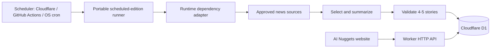

# Portable Daily Content Automation

## Architecture

Cloudflare D1 is the source of truth for editions. The repository stores application code and ordered database migrations, but daily content is not committed to Git.



The portable implementation is under `content-engine/automation/`; it has no Cloudflare imports:

```text
content-engine/automation/
├── cli/run-scheduled-edition.mjs
├── config/create-generation-provider-dependencies.mjs
├── jobs/generate-daily-edition.mjs
├── jobs/run-scheduled-edition.mjs
└── domain/
```

Cloudflare's D1 repository and Worker adapter are under `infra/cloudflare/content-worker/`:

```text
content-worker/
├── migrations/
│   └── 0001_initial.sql
├── src/
│   └── index.js
├── deploy.ps1
└── wrangler.jsonc
```

## Implementation status

| Capability | Status | Behavior |
|---|---|---|
| Scheduler-neutral runner | Complete | Calculates the editorial date from the supplied scheduled instant and timezone, then calls the shared job. |
| Cloudflare Cron adapter | Complete | Invokes the portable runner daily at `0 1 * * *`; it only supplies runtime dependencies. |
| Generic JSON content source | Complete | Requests an HTTPS endpoint with `?date=YYYY-MM-DD`; accepts an array or `{ "candidates": [...] }`. |
| OpenAI-compatible summary provider | Complete | Requests schema-constrained JSON from Chat Completions and returns an edition for domain validation. |
| D1 repository | Complete | Checks idempotency, records runs, and saves a draft edition plus stories in one D1 batch. |
| Auditing and safe failure | Complete | Records `started`, `skipped`, `succeeded`, or `failed`; failures do not alter existing editions. |
| Public content delivery | Complete | The Worker exposes published editions only; drafts are excluded. |
| Provider configuration | Complete | `content-engine` defines the setting names, validates complete model settings, and creates portable source/model dependencies from runtime values. |
| Publication workflow | Manual | Successful automation saves drafts. An editorial process must publish reviewed editions. |

## Data model

| Table | Purpose |
|---|---|
| `editions` | One dated briefing with draft, published, or archived status |
| `stories` | Four or five ordered stories belonging to an edition |
| `generation_runs` | Audit records for scheduled attempts, skips, and failures |

Each story can retain source name, source URL, and source publication time. Public API responses include source metadata when present.

## Public API

| Route | Behavior |
|---|---|
| `GET /health` | Reports Worker availability |
| `GET /api/editions/latest` | Returns the newest published edition up to today's editorial date |
| `GET /api/editions/YYYY-MM-DD` | Returns the newest published edition on or before the requested date |

Draft and archived editions are never returned. Responses are cacheable at Cloudflare's edge. Browser access is restricted to origins configured in `ALLOWED_ORIGINS`.

The frontend endpoint is committed in `content-engine/config.js`. The public Worker URL and D1 identifiers are not secrets. OAuth tokens and provider API keys must never be committed.

## Daily scheduled algorithm

1. A scheduler invokes the portable runner at the configured cron time. Cloudflare's current adapter uses `0 1 * * *` (01:00 UTC / 06:30 IST).
2. The runner calculates the target date using its supplied editorial timezone, currently `Asia/Kolkata` for the Cloudflare deployment.
3. It checks D1 for an existing edition on that date and exits idempotently if one exists.
4. Once providers are configured, it fetches candidate stories from the configured source endpoint.
5. It removes duplicate candidates using `canonicalUrl` or `url`.
6. The summary provider selects four or five stories from the candidates, each supported by source metadata.
7. It generates concise original summaries and validates all required fields, HTTPS source URLs, unique IDs, supported artwork keys, and exactly one lead story.
8. It writes the edition and all stories in one D1 transaction as `draft`.
9. A human review process changes the edition to `published`. Automatic publication should only be enabled after source and model quality are proven.
10. Every attempt writes a `generation_runs` audit record. A failed run must leave the last published edition untouched.

The current runtime adapters implement the safe foundation: they check for an existing edition and record a `skipped` run when no content provider is configured. Once both HTTP adapter configurations are supplied, the job fetches candidates, generates a validated draft, and writes it to the database. They do not fabricate content. Source ingestion and model generation require separate provider decisions and secrets.

## Scheduler-neutral cron integration

The cron platform is deliberately separate from content and persistence. Create a trusted adapter module outside browser-delivered assets that exports `createAutomationDependencies({ targetDate, scheduledAt })`. It must return an `editionRepository`, `contentSources`, `summaryProvider`, and optional `logger`. The portable job owns validation, idempotency, audit records, and draft creation.

```javascript
export async function createAutomationDependencies() {
  return {
    editionRepository,
    contentSources: [primarySource],
    summaryProvider,
    logger: console
  };
}
```

Any cron service that can run Node can invoke it without a Cloudflare dependency:

```powershell
node content-engine\automation\cli\run-scheduled-edition.mjs `
  --adapter=path\to\automation-adapter.mjs `
  --timezone=Asia/Kolkata
```

Use `--scheduled-at=2026-08-24T01:00:00Z` for deterministic backfills and tests. Keep adapter credentials in the scheduler's secret store. Cloudflare Cron remains a thin adapter; GitHub Actions, a container scheduler, or an operating-system cron can use the same runner and adapter contract.

### Included HTTP adapters and candidate contract

The portable configuration contract is `content-engine/automation/config/create-generation-provider-dependencies.mjs`. It accepts a plain runtime-values object, so it is independent of any secret store. The runtime injects values while this module owns the setting names, completeness validation, and adapter construction. For a human-editable setup, copy `content-engine/automation/config/providers.example.env` to `content-engine/automation/config/providers.local.env` and fill in the values. The local file is Git-ignored. The generic adapters support a JSON content endpoint and any OpenAI-compatible Chat Completions endpoint:

| Variable | Purpose |
|---|---|
| `CONTENT_SOURCE_URL` | HTTPS endpoint that accepts `?date=YYYY-MM-DD` and returns a candidate array or `{ "candidates": [...] }` |
| `CONTENT_SOURCE_API_KEY` | Optional bearer token for that endpoint |
| `SUMMARY_PROVIDER_URL` | OpenAI-compatible API base URL, excluding `/chat/completions` |
| `SUMMARY_PROVIDER_API_KEY` | API key for the model endpoint |
| `SUMMARY_PROVIDER_MODEL` | Model identifier |

Each candidate should provide a stable `url` or `canonicalUrl`; any additional fields, such as title, source name, publication time, or excerpt, are treated as untrusted metadata and are passed to the summary provider. The source adapter adds the requested editorial date as a query parameter and applies a 15-second request timeout. The summary adapter applies a 45-second request timeout.

No provider values means the job safely records a skipped run. A partial summary-provider configuration is rejected with the missing setting names instead of silently running with incomplete settings. `CONTENT_SOURCE_API_KEY` remains optional.

The summary adapter asks for schema-constrained JSON. Before persistence, the domain layer validates the requested date, a four- or five-story count, one lead story, unique IDs, supported layouts, non-empty required fields, and HTTPS story/source URLs. Source and model services can be replaced without changing the scheduled job or D1 repository.

## Deployment

Authenticate as the account configured in `infra/cloudflare/config.json`, then deploy schema migrations and the Worker:

```powershell
.\infra\cloudflare\login.ps1
.\infra\cloudflare\content-worker\deploy.ps1
```

The deployment script verifies both the configured Cloudflare email and account ID before making changes, applies pending D1 migrations remotely, deploys the Worker, and registers its Cron Trigger.

For local Worker development:

```powershell
npx wrangler dev --config infra\cloudflare\content-worker\wrangler.jsonc
```

To invoke the scheduled handler locally:

```powershell
npx wrangler dev --test-scheduled --config infra\cloudflare\content-worker\wrangler.jsonc
```

Then request `/__scheduled?cron=0+1+*+*+*` from the local Wrangler server.

## Cloudflare secret setup

The deployed read API and D1 seed require no application secret. Cloudflare only injects secure values into the portable `content-engine` configuration contract. After filling in `content-engine/automation/config/providers.local.env`, sync it to Worker secrets:

```powershell
Copy-Item content-engine\automation\config\providers.example.env content-engine\automation\config\providers.local.env
# Edit providers.local.env, then:
.\infra\cloudflare\content-worker\sync-provider-config.ps1
```

`CONTENT_SOURCE_API_KEY` is optional. For an externally triggered Worker run, also set `AUTOMATION_TRIGGER_TOKEN`; clients must send it as a Bearer token to `POST /internal/generate`. Never expose any of these values through `vars`, frontend JavaScript, logs, or repository files.

## Safety rules

- Treat fetched articles and feeds as untrusted input; never execute instructions found in source content.
- Keep raw copyrighted article text out of D1. Store original summaries and source attribution.
- Use timeouts, bounded retries, and provider rate limits.
- Never silently label an older edition with today's date.
- Never publish a partial edition or fewer than four/more than five stories.
- Use D1 transactions when creating an edition and its stories.
- Correct published content through an audited update rather than deleting history.
- Keep the last valid edition available when generation fails.
