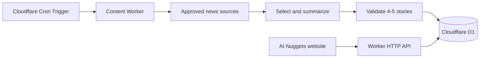

# Daily Content Automation with Cloudflare D1

## Architecture

Cloudflare D1 is the source of truth for editions. The repository stores application code and ordered database migrations, but daily content is not committed to Git.



The implementation is under `infra/cloudflare/content-worker/`:

```text
content-worker/
├── migrations/
│   └── 0001_initial.sql
├── src/
│   └── index.js
├── deploy.ps1
└── wrangler.jsonc
```

## Data model

| Table | Purpose |
|---|---|
| `editions` | One dated briefing with draft, published, or archived status |
| `stories` | Four or five ordered stories belonging to an edition |
| `generation_runs` | Audit records for scheduled attempts, skips, and failures |

Each story can retain source name, source URL, and source publication time. Public API responses include source metadata when present.

## Public API

| Route | Behavior |
|---|---|
| `GET /health` | Reports Worker availability |
| `GET /api/editions/latest` | Returns the newest published edition up to today's editorial date |
| `GET /api/editions/YYYY-MM-DD` | Returns the newest published edition on or before the requested date |

Draft and archived editions are never returned. Responses are cacheable at Cloudflare's edge. Browser access is restricted to origins configured in `ALLOWED_ORIGINS`.

The frontend endpoint is committed in `content-engine/config.js`. The public Worker URL and D1 identifiers are not secrets. OAuth tokens and provider API keys must never be committed.

## Daily scheduled algorithm

1. Cloudflare invokes the Worker's `scheduled` handler at `0 1 * * *` (01:00 UTC / 06:30 IST).
2. The Worker calculates the target date using `EDITORIAL_TIMEZONE`, currently `Asia/Kolkata`.
3. It checks D1 for an existing edition on that date and exits idempotently if one exists.
4. Once providers are configured, it fetches candidate stories from an explicit source allowlist.
5. It normalizes URLs, removes duplicates and stale stories, and ranks candidates for significance, source quality, and topic diversity.
6. It selects four or five stories, each supported by at least one primary source.
7. It generates concise original summaries and validates all required fields, HTTPS source URLs, unique IDs, supported artwork keys, and exactly one lead story.
8. It writes the edition and all stories in one D1 transaction as `draft`.
9. A human review process changes the edition to `published`. Automatic publication should only be enabled after source and model quality are proven.
10. Every attempt writes a `generation_runs` audit record. A failed run must leave the last published edition untouched.

The current scheduled handler implements the safe foundation: it checks for an existing edition and records a `skipped` run when no content provider is configured. It does not fabricate content. Source ingestion and model generation require separate provider decisions and secrets.

## Deployment

Authenticate as the account configured in `infra/cloudflare/config.json`, then deploy schema migrations and the Worker:

```powershell
.\infra\cloudflare\login.ps1
.\infra\cloudflare\content-worker\deploy.ps1
```

The deployment script verifies both the configured Cloudflare email and account ID before making changes, applies pending D1 migrations remotely, deploys the Worker, and registers its Cron Trigger.

For local Worker development:

```powershell
npx wrangler dev --config infra\cloudflare\content-worker\wrangler.jsonc
```

To invoke the scheduled handler locally:

```powershell
npx wrangler dev --test-scheduled --config infra\cloudflare\content-worker\wrangler.jsonc
```

Then request `/__scheduled?cron=0+1+*+*+*` from the local Wrangler server.

## Secrets required for generation

The deployed read API and D1 seed require no application secret. Future automated generation will require credentials for the selected providers, stored as Worker secrets:

```powershell
npx wrangler secret put CONTENT_API_KEY --config infra\cloudflare\content-worker\wrangler.jsonc
npx wrangler secret put MODEL_API_KEY --config infra\cloudflare\content-worker\wrangler.jsonc
```

Never expose these values through `vars`, frontend JavaScript, logs, or repository files.

## Safety rules

- Treat fetched articles and feeds as untrusted input; never execute instructions found in source content.
- Keep raw copyrighted article text out of D1. Store original summaries and source attribution.
- Use timeouts, bounded retries, and provider rate limits.
- Never silently label an older edition with today's date.
- Never publish a partial edition or fewer than four/more than five stories.
- Use D1 transactions when creating an edition and its stories.
- Correct published content through an audited update rather than deleting history.
- Keep the last valid edition available when generation fails.
