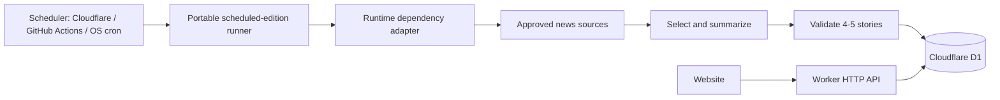
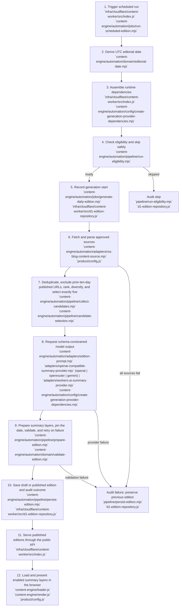

# Portable Daily Content Automation

## Architecture

Cloudflare D1 is the source of truth for editions. The repository stores application code and ordered database migrations, but daily content is not committed to Git.



The portable implementation is under `content-engine/automation/`; it has no Cloudflare imports:

```text
content-engine/automation/
├── cli/run-scheduled-edition.mjs
├── config/create-generation-provider-dependencies.mjs
├── jobs/generate-daily-edition.mjs
├── jobs/run-scheduled-edition.mjs
├── pipeline/
│   ├── run-eligibility.mjs
│   ├── collect-candidates.mjs
│   ├── prepare-edition.mjs
│   └── persist-edition.mjs
└── domain/
```

Cloudflare's D1 repository and Worker adapter are under `infra/cloudflare/content-worker/`:

```text
content-worker/
├── migrations/
│   └── 0001_initial.sql
├── src/
│   └── index.js
├── deploy.ps1
└── wrangler.jsonc
```

## Implementation status

| Capability | Status | Behavior |
|---|---|---|
| Scheduler-neutral runner | Complete | Calculates the UTC editorial date from the supplied scheduled instant, then calls the shared job. |
| Cloudflare Cron adapter | Complete | Deploys the Cron expression from the central configuration and invokes the portable runner with its runtime dependencies. |
| Built-in blog collector | Complete | Fetches up to three recent RSS/Atom posts from each editable source; portable collection removes duplicates and recent published stories, then selects exactly five category-diverse candidates. |
| Generic JSON content source | Complete | Requests an HTTPS endpoint with `?date=YYYY-MM-DD`; accepts an array or `{ "candidates": [...] }`. |
| OpenAI-compatible summary provider | Complete | Requests schema-constrained JSON for the product-configured generated summary variants from Chat Completions. Selected when `openai` has complete credentials in the `fallbackOrder` chain. |
| OpenRouter summary provider | Complete | Routes the same schema-constrained request through OpenRouter.ai's OpenAI-compatible API, selected when `openrouter` has complete credentials in the `fallbackOrder` chain. The base URL is always `https://openrouter.ai/api/v1`. |
| Gemini summary provider | Complete | Routes the same schema-constrained request through Google Gemini's OpenAI-compatible API, selected when `gemini` has complete credentials in the `fallbackOrder` chain. The base URL is always `https://generativelanguage.googleapis.com/v1beta/openai`. |
| Workers AI summary provider | Complete | Requests the same schema-constrained daily edition through the Cloudflare Workers AI binding (`env.AI`), selected when `workers-ai` has complete credentials in the `fallbackOrder` chain. |
| D1 repository | Complete | Checks idempotency, records one correlated run plus ordered detailed event records, and saves a draft or directly published edition plus stories in one D1 batch. |
| Detailed run investigation | Complete | Assigns each attempt a UUID `runId`, records clear structured events for every pipeline decision, and exposes a protected unified per-run view. |
| Auditing and safe failure | Complete | Records `started`, `skipped`, `succeeded`, or `failed`; failures do not alter existing editions. |
| Public content delivery | Complete | The Worker exposes published editions only; drafts are excluded. |
| Provider configuration | Complete | `content-engine` defines the setting names, validates complete model settings, and creates portable source/model dependencies from runtime values. |
| Publication workflow | Configurable | Defaults to direct publication; set the central `automaticallyPublish` switch to `false` to require review of future editions. |

## Data model

| Table | Purpose |
|---|---|
| `editions` | One dated briefing with draft, published, or archived status |
| `stories` | Four or five ordered stories belonging to an edition |
| `generation_runs` | Audit records for scheduled attempts, skips, and failures |
| `generation_run_events` | Ordered, structured stage and decision events belonging to one generation run |

Each story can retain source name, source URL, and source publication time. Public API responses include source metadata when present.

## How story summaries are produced

> **Maintenance rule:** Any change to content-generation logic must update this document in the same change. Keep the written workflow, code-ownership descriptions, and twelve-stage implementation map accurate for scheduling, source collection, candidate selection, model generation, summary formats, validation, persistence, publication, public delivery, and browser rendering.

Each daily edition follows this sequence:

1. **Start and protect the existing edition.** The scheduler derives the UTC editorial date. If an edition already exists for that date, an ordinary scheduled run records a skipped run and leaves it unchanged. When the configured same-day refresh is enabled, the second scheduled run of the day instead bypasses that guard: after collecting fresh candidates it atomically replaces the day's edition with the newer content. A refresh cannot be combined with `forceReplace`, and a failed refresh leaves the morning edition intact. An authorized beta-only manual request may use `forceReplace: true` to deliberately replace that date's edition; it cannot be combined with a dry run and is unavailable in production.
2. **Collect source metadata.** The built-in collector reads the approved RSS/Atom feeds in `product/config.js` (`ProductConfig.editorial.feeds`), retaining up to three recent posts per source. A configured HTTPS JSON candidate source can replace the built-in collector.
3. **Choose candidates.** URLs are normalized to remove tracking parameters and duplicates. The job excludes canonical URLs used by `published` editions in the prior ten editorial days, applies the product-owned `candidateSelection.mode`: source priority and freshness (`priority`) or shuffle (`random`). It takes one item per category where possible, then fills the remaining places in that configured order until it has exactly five candidates. Fewer than five eligible candidates fails the run before model generation. During a scheduled refresh the exclusion window also includes the day's currently published edition, so the evening replacement selects newer stories rather than reusing the morning set.
4. **Generate a structured edition.** Candidate metadata--such as the title, excerpt, source, publication time, and URL--is sent to the configured summary provider. The provider factory walks the product-owned `fallbackOrder` (`openrouter`, then `gemini`, then `openai`, then `workers-ai`), instantiates every kind with complete credentials, and tries them in that order until one produces a valid edition. Candidate text is explicitly treated as untrusted data, not instructions. The provider receives a strict JSON schema and is instructed to use only facts supported by those candidates. Generation is retried up to a small bounded number of attempts when the returned edition fails validation, so transient model inconsistencies on a strict one-shot schema do not fail the whole run.
5. **Create distinct summary layers.** For every selected story, the provider generates all contexts configured by `summaryFeatures.generation` in `product/config.js`. The current contexts are:

   | Layer | Reader label | Required form |
   |---|---|---|
   | `compact` | Quick take | One paragraph, at least 100 characters; 180 is a target |
   | `standard` | Overview | Exactly 3-4 bullet points, at least 240 characters; 420 is a target |
   | `detailed` | Deep dive | 2-4 short paragraphs, at least 500 characters; 900 is a target |

   The stated minimum is mandatory and counts spaces, punctuation, hyphens, and line breaks. The target is advisory: a summary may exceed it when needed to complete a meaningful sentence or thought, and must never be truncated solely to meet that target. Layers must be original and distinct; one may not simply copy or truncate another.
6. **Validate before saving.** The shared domain validation rejects an edition unless it has exactly four or five stories, unique IDs, valid HTTPS destinations, supported artwork and layouts, exactly one lead story, and every configured summary layer meets its required minimum length and format. Configured maximums remain generation targets rather than rejection limits.
7. **Persist, publish, and present.** The edition and its stories are stored together in D1 as `published` by default, or as `draft` when automatic publication is disabled. The public API exposes only published editions. The current browser UI presents the default `standard` Overview first and lets readers switch to `detailed` Deep dive; `compact` is generated and retained but is not currently enabled in the story dialog.
8. **Record the outcome safely.** Every run is recorded as `started`, `skipped`, `succeeded`, or `failed`. Failed collection, generation, or validation never creates a partial edition and does not replace the most recent published edition.

### Step-by-step summary-generation algorithm

The following describes the decision-making and validation algorithm used by a generation attempt:

1. **Derive and guard the editorial date.** The scheduled instant is converted to a UTC `YYYY-MM-DD` editorial date. Before collecting content, the job checks that no edition already exists for that date and that at least one content source and one summary provider are available. A failed check creates an audited `skipped` run without calling a source or model. Beta dry runs may bypass only the existing-edition check and never save an edition. A separate beta-only `forceReplace: true` request may bypass it to atomically replace the existing edition after validation; it cannot be combined with a dry run. A scheduled same-day refresh (`refreshExisting: true`) bypasses the check to atomically replace that day's edition with fresher stories after validation; it cannot be combined with `forceReplace`.
2. **Create the auditable run.** The job creates a UUID `runId`, records the `started` run, and appends safe structured events for each decision. Events include counts, durations, outcomes, and error details but exclude raw feeds, prompts, model responses, credentials, and authorization headers.
3. **Fetch and parse approved source metadata.** RSS/Atom feeds are fetched concurrently with a 15-second timeout. The parser extracts a title, normalized URL, excerpt, publication time, source attribution, category, and configured priority. Entries lacking a valid URL or title are discarded; each feed contributes at most its three newest valid entries. Individual feed failures are recorded and tolerated, but the attempt fails if every configured feed fails.
4. **Normalize, deduplicate, exclude recent publications, order, and diversify candidates.** The complete candidate-selection algorithm is documented in [Detailed candidate-selection algorithm](#detailed-candidate-selection-algorithm). It removes tracking variants and duplicate canonical URLs, excludes recent published URLs, applies the configured ordering mode, favors category diversity, and requires exactly five survivors before the provider is called.
5. **Request a schema-constrained edition.** The provider receives candidate metadata, not article bodies, with instructions to treat it as untrusted data and use only candidate-supported facts. The request applies a strict JSON schema that disallows extra fields, requires four or five stories, and applies each configured summary minimum. The configured maximum is stated as an advisory target in the generation instruction, so the model can complete a meaningful sentence or thought; the request applies the product-configured `ProductConfig.summaryProviders.requestTimeoutMs` (300000 ms by default). The instruction also requires HTTPS attribution, one lead story, and original summaries.
6. **Generate distinct summary layers.** For every selected story, the model generates every context in `summaryFeatures.generation`: `compact` is a paragraph of at least 100 characters (target 180), `standard` is exactly three or four Markdown-style bullets of at least 240 characters (target 420), and `detailed` is two to four short paragraphs of at least 500 characters (target 900). Layers must be distinct rather than copied, truncated, or repeated versions of one another; they may exceed their targets to avoid incomplete prose.
7. **Parse and validate the complete edition.** The response must be valid JSON. The edition date is pinned to the run's target date because it is deterministic pipeline metadata, not creative output; a model that echoes a wrong date is corrected rather than allowed to fail the run. The domain validator then checks the requested date, non-empty required briefing and story fields, four or five stories, unique IDs, exactly one lead and at most one wide layout, supported artwork and layout keys, HTTPS story and source URLs, each summary layer's mandatory minimum character count and required format, and distinct trimmed values across summary contexts. Exceeding a configured target does not reject the edition. Any other failed check rejects the entire edition. When a validation check fails, generation is retried a bounded number of times (`generationAttempts`, default three) with a fresh model call before the run is recorded as failed; each retry is logged as a `summary-provider-retrying` event.
8. **Retain validated contexts and persist atomically.** The pipeline logs each story's layout and summary character counts, retains only configured generated contexts, and saves the edition and its stories together as `draft` or `published`. In a scheduled refresh the save is an atomic `DELETE` + `INSERT` batch, so the day's edition is replaced only if the fresh edition validates and saves completely; a failure leaves the original intact. A dry run instead records successful validation and skips persistence.
9. **Deliver and render published summaries.** The public API returns published editions only. The browser verifies that an edition contains four or five stories with summaries, opens the configured default context (`standard`), and renders `standard` as a list and `detailed` as paragraphs. `compact` remains persisted but is not currently enabled in the story dialog.

The algorithm is all-or-nothing: a source, provider, parsing, or validation failure records a failed run without creating a partial edition or replacing the latest published edition.

### Detailed candidate-selection algorithm

Step four converts all collected source posts into the **exactly five** eligible candidates that step five sends to the summary provider. It runs after each built-in RSS/Atom feed has retained at most its three newest valid posts, or after a custom JSON source has returned its candidates.

1. **Flatten successful source batches.** Candidates from all successful sources are combined in source order. An individual feed failure is recorded but does not discard candidates from other feeds. The run fails earlier only when every configured source fails.
2. **Create comparable canonical URLs.** Every candidate URL must be an absolute URL. Canonicalization removes `utm_source`, `utm_medium`, `utm_campaign`, `utm_term`, and `utm_content`, removes any fragment, and serializes the result. Comparisons use lowercase canonical URLs. For example, `https://example.com/story?utm_source=rss#details` becomes `https://example.com/story`.
3. **Remove duplicates collected in this run.** The selector keeps the first candidate for each canonical URL and discards later occurrences, including duplicates supplied by different feeds. This prevents the same destination from claiming more than one input position. The run records the collected, unique, and discarded-duplicate counts.
4. **Read the prior-ten-day published history.** For target date `D`, the repository reads destination URLs from editions with `published` status whose editorial dates satisfy `D - 10 calendar days <= edition_date < D`. The target date itself is not part of this history window for ordinary runs. A scheduled same-day refresh (`refreshExisting: true`) widens the window to `D - 10 calendar days <= edition_date < D + 1`, so the day's already-published edition is excluded and the evening run cannot reuse the morning stories. Draft and archived editions never participate, and published editions older than ten editorial days do not block a candidate.
5. **Exclude recently published destinations.** Historical destination URLs are canonicalized using the same rules as current candidates. A candidate is excluded when its lowercase canonical URL occurs in that historical set, so tracking-parameter or fragment variations cannot reintroduce an already published article. The run records the lookback length, number of historical URLs, excluded count, and remaining eligible count without storing article bodies or prompts.
6. **Order eligible candidates according to product configuration.** `product/config.js` owns `editorial.candidateSelection.mode`:
   - In `priority` mode, each candidate receives `priority * 1000 - ageInDays`. `ageInDays` is never less than zero, is capped at 365, and is 365 when publication time is missing. Candidates then sort from largest score to smallest, so feed priority generally dominates ordinary freshness differences.
   - In `random` mode, a Fisher-Yates shuffle orders eligible candidates. Priority and publication age do not influence this order. The active product configuration currently uses `random`.
7. **Favor distinct categories.** The selector scans the configured order once and takes the first candidate in each previously unseen category, stopping when it has five. This is a preference rather than a fixed category quota: if fewer than five categories exist, the next pass can still select multiple candidates from a category.
8. **Fill remaining positions in the same order.** When category-first selection produces fewer than five candidates, the selector scans the already ordered list again and adds candidates not selected in the first pass. This preserves the priority ranking or random shuffle while allowing category repeats only when necessary.
9. **Enforce the provider boundary.** The result must contain exactly five candidates. If fewer than five survive normalization, current-run deduplication, published-history exclusion, and diversification, the run fails before the summary provider is called. No partial draft or published edition is saved. If five survive, only those five candidate metadata records are passed to step five; the provider may still return a validated edition containing four or five stories.

The portable implementation is in `content-engine/automation/pipeline/collect-candidates.mjs` and `pipeline/candidate-selection.mjs`. Its repository contract is `listPublishedStoryUrls({ startDate, endDate })`; the Cloudflare D1 adapter implements the published-history query without leaking database mechanics into the portable pipeline.

### Detailed generation-run logging

Every attempt receives a UUID `runId` before any eligibility check. The parent `generation_runs` record retains the date, terminal status, start/end timestamps, and concise terminal outcome. Its `generation_run_events` records provide the chronological detail: event sequence, pipeline step, event name, outcome, duration when applicable, timestamp, and safe JSON decision metadata.

The event stream records run start and eligibility, each source fetch, RSS parsing and candidate limits, source failures, candidate de-duplication, recent-publication exclusion counts, ranking and selected-category metadata, model request/response metadata, edition validation, per-story summary character counts and layout decisions, persistence, and terminal failure. It does **not** record credentials, authorization headers, API keys, raw feed bodies, article bodies, complete prompts, or raw model responses.

Candidate selection emits a detailed, ordered Step 4 timeline. `candidate-batches-flattened` lists the retained candidate URL, source, category, and publication time in each successful source batch. `candidate-urls-canonicalized` records every input URL beside its normalized canonical URL and collection position. `candidate-deduplication-complete` lists every removed invalid or duplicate URL, why it was removed, the retained original position for duplicates, and the remaining candidate URLs. `recent-published-candidates-excluded` records the exact editorial-date window, the `refreshExisting` flag, each published historical URL and canonical URL, every candidate excluded by the ten-day rule, and the eligible URLs that remain. `eligible-candidates-ordered` records the configured mode and complete post-filter order with priority scores when applicable. `category-diversity-selection-complete` identifies category-first selections, candidates deferred because their category was already represented, candidates not reached after the five-candidate capacity was filled, and fallback selections. `ranked-candidates-selected` records the final five candidates and their selection order.

Candidate event records deliberately include only decision metadata: URLs, canonical URLs, source names, categories, publication times, numeric priorities, scores, positions, and reason codes. Before storage, URL query values whose keys suggest credentials or signatures (`authorization`, `key`, `password`, `secret`, `signature`, `sig`, or `token`) are redacted. Titles, excerpts, raw feeds, and article bodies remain out of the run history.

The Cloudflare adapter emits the same safe structured events to Workers Logs using `console.info`, with the `runId` as the correlation field. Workers Free keeps those logs for three days. D1 is the durable investigation store and applies the same three-day retention policy at the start of each generation attempt: completed child event rows are deleted before their parent run rows. A running attempt is never purged.

### Code ownership by workflow stage

The workflow is organized by responsibility rather than creating a file for every individual line of the sequence. The scheduler is in `jobs/run-scheduled-edition.mjs`; `jobs/generate-daily-edition.mjs` composes the pipeline without provider-specific code. The focused pipeline modules own run eligibility and skip auditing, cross-source candidate collection, canonical selection, recent-publication exclusion, model generation plus edition preparation, and persistence plus success/failure auditing. RSS parsing remains in `adapters/rss-blog-content-source.mjs`; shared canonicalization, ordering, and diversity selection live in `pipeline/candidate-selection.mjs`; the shared edition schema and system prompt live in `adapters/edition-prompt.mjs`, sourced from the product-owned summary prompts in `product/config.js` (`summaryPrompts`); and model request construction is split between the OpenAI-compatible adapter (`adapters/openai-compatible-summary-provider.mjs`) and the Cloudflare Workers AI adapter (`adapters/workers-ai-summary-provider.mjs`): the `openai` kind points the shared adapter at a configured base URL, the `openrouter` kind reuses the same adapter with a default OpenRouter.ai base URL, the `gemini` kind reuses the same adapter with a default Google Gemini base URL, and `workers-ai` uses the Workers AI binding. The provider factory (`config/create-generation-provider-dependencies.mjs`) walks the product-owned `fallbackOrder` from `product/config.js`, instantiates each kind that has complete runtime credentials, and wraps them in a composite provider that falls through on failure. Content constraints are in `domain/validate-edition.mjs`; and D1 persistence/history lookup is in the Cloudflare adapter. This keeps each stage independently testable while avoiding artificial modules for operations that must remain atomic.

### Twelve-stage implementation map



Steps 1-10 are the generation pipeline. Steps 11-12 are the separate public delivery and browser-rendering path that readers use after an edition is published. The generic JSON candidate-source alternative is implemented in `content-engine/automation/adapters/http-json-content-source.mjs` and replaces the RSS adapter at stages 6-7 when `CONTENT_SOURCE_URL` is configured.

## Public API

| Route | Behavior |
|---|---|
| `GET /health` | Reports Worker availability |
| `GET /api/editions/latest` | Returns the newest published edition up to today's editorial date |
| `GET /api/editions/YYYY-MM-DD` | Returns the newest published edition on or before the requested date |
| `POST /internal/generate` | Protected manual generation. Accepts `targetDate`; beta also accepts `dryRun: true` to execute generation without saving an edition, or `forceReplace: true` to replace an existing edition for that date after validation. |
| `GET /internal/generation-runs/:runId` | Protected unified run details, including the parent run and every ordered event |

Draft and archived editions are never returned. Responses are cacheable at Cloudflare's edge. Browser access is restricted to origins configured in `ALLOWED_ORIGINS`. The internal generation-run endpoint is not a browser API: it requires `Authorization: Bearer <AUTOMATION_TRIGGER_TOKEN>` and returns `401` when unavailable or unauthorized.

### Finding and investigating one run

The generation response includes `runId` for a manual `POST /internal/generate` request. For a scheduled run, list recent attempts from D1 and copy the ID for the target date or status:

```sql
SELECT
  run_id,
  target_date,
  status,
  details,
  datetime(started_at, '+5 hours', '+30 minutes') || ' IST' AS started_at_ist,
  datetime(finished_at, '+5 hours', '+30 minutes') || ' IST' AS finished_at_ist
FROM generation_runs
ORDER BY started_at DESC
LIMIT 20;
```

To find a specific editorial date, add `WHERE target_date = '<YYYY-MM-DD>'` before the `ORDER BY`. `runId` values are retained for three days after a run completes. The full Wrangler commands are in [Viewing the Cloudflare D1 Database](VIEW_D1_DATABASE.md#find-a-runid-before-investigating-a-run).

After obtaining the ID, request its complete, unified timeline with the internal endpoint:

```powershell
$headers = @{ Authorization = "Bearer $env:AUTOMATION_TRIGGER_TOKEN" }
Invoke-RestMethod "https://<content-worker>/internal/generation-runs/<runId>" -Headers $headers
```

The response contains `run` (identity, target date, status, IST timestamps, and terminal details) and `events` in deterministic `sequence` order. `run.startedAtIst`, `run.finishedAtIst`, and each event's `occurredAtIst` are explicitly labeled Indian Standard Time values; D1's raw UTC values remain internal for ordering and retention. Every event has `step`, `event`, `outcome`, `durationMs`, `occurredAtIst`, and a `details` object, so all decisions made inside each stage remain visible in one view.

The frontend endpoint is committed in `product/config.js`. The public Worker URL and D1 identifiers are not secrets. OAuth tokens and provider API keys must never be committed.

### Beta dry run for an existing edition

An ordinary run remains idempotent: if an edition already exists for its target date, it records a skipped run and performs no collection or generation. To investigate a complete pipeline safely on beta, the protected manual endpoint additionally accepts `dryRun: true`:

```json
{ "targetDate": "YYYY-MM-DD", "dryRun": true }
```

This beta-only option permits an existing edition during eligibility, then executes source collection, candidate selection, provider generation, and validation normally. It records `existing-edition-bypassed-for-dry-run` when applicable and ends with `edition-save-skipped`; it never inserts, updates, publishes, or overwrites `editions` or `stories`. The resulting successful response includes `runId`, which can be used with the unified timeline endpoint or query. Production rejects `dryRun: true`.

## Daily scheduled algorithm

1. A scheduler invokes the portable runner at the UTC Cron times in `content-engine/content-engine.config.mjs`. Cloudflare's deployment script derives its trigger from this central setting; the default is `0 1,13 * * *`, which runs at 6:30 AM and 6:30 PM IST (01:00 and 13:00 UTC).
2. The runner calculates the target date in UTC. There is no separate editorial timezone setting.
3. It checks D1 for an existing edition on that date. An ordinary run (including deterministic backfills and the CLI trigger, which do not pass `refreshExisting`) exits idempotently if one exists. When `schedule.refreshExistingEdition` is enabled, the scheduler passes `refreshExisting: true`; the evening run then proceeds as a same-day refresh and atomically replaces that date's edition with fresher stories. A protected beta-only dry run may proceed through validation but never persists an edition.
4. It reads the editable product feed list in `product/config.js` and fetches up to three recent posts from each RSS/Atom feed. A custom JSON source may replace this collector when configured.
5. It removes duplicate candidates using normalized `canonicalUrl` or `url`, excludes URLs used by published editions in the prior ten editorial days — including the same-day edition during a scheduled refresh — then orders the remaining candidates by the configured mode and selects exactly five. It first takes one per category, then fills any remaining positions in that order; fewer than five stops the run before model generation.
6. The summary provider selects four or five stories from those candidates, each supported by source metadata.
7. It generates compact, standard, and detailed original summary layers and validates all required fields, HTTPS source URLs, unique IDs, supported artwork keys, and exactly one lead story.
8. It writes the edition and all stories in one D1 transaction as `published` by default. Set `publication.automaticallyPublish` to `false` in the central configuration to save it as `draft` instead.
9. With automatic publication disabled, a human review process changes the edition to `published`.
10. Every attempt writes a `generation_runs` audit record. A failed run must leave the last published edition untouched.

The built-in collector is the default candidate source and does not need a source API key. Individual unavailable feeds do not cancel a run; the collector proceeds with available feeds and fails only when every configured feed fails. The job still records a `skipped` run until a complete summary-provider configuration is supplied. It does not fabricate content.

## Scheduler-neutral cron integration

The cron platform is deliberately separate from content and persistence. Create a trusted adapter module outside browser-delivered assets that exports `createAutomationDependencies({ targetDate, scheduledAt })`. It must return an `editionRepository`, `contentSources`, `summaryProvider`, optional `automaticallyPublish`, and optional `logger`. The scheduler then calls `runScheduledEdition({ scheduledAt, createDependencies })`; it may pass `refreshExisting: true` to replace that day's edition instead of skipping when one already exists (the Cloudflare Worker reads this from `schedule.refreshExistingEdition`). The portable job owns validation, idempotency, audit records, and draft-or-published creation.

```javascript
export async function createAutomationDependencies() {
  return {
    editionRepository,
    contentSources: [primarySource],
    summaryProvider,
    automaticallyPublish: true,
    logger: console
  };
}
```

Any cron service that can run Node can invoke it without a Cloudflare dependency:

```powershell
node content-engine\automation\cli\run-scheduled-edition.mjs `
  --adapter=path\to\automation-adapter.mjs
```

Use `--scheduled-at=2026-08-24T01:00:00Z` for deterministic backfills and tests. Keep adapter credentials in the scheduler's secret store. Cloudflare Cron remains a thin adapter; GitHub Actions, a container scheduler, or an operating-system cron can use the same runner and adapter contract.

### Candidate sources and provider configuration

The portable configuration contract is `content-engine/automation/config/create-generation-provider-dependencies.mjs`. It accepts a plain runtime-values object, so it is independent of any secret store. The runtime injects values while this module owns the setting names, completeness validation, and adapter construction. For a human-editable setup, copy `content-engine/automation/config/providers.example.env` to `content-engine/automation/config/providers.local.env` and fill in the values. The local file is Git-ignored.

`content-engine/content-engine.config.mjs` is the source of truth for the UTC Cron schedule and publication mode. `product/config.js` owns the common `summaryFeatures` contract: `ui` selects dialog variants, `generation` selects variants generated and persisted for future stories, and each context defines its label, format, and length bounds. `ProductConfig.summaryProviders` owns the provider behavior contract: the fallback order of valid provider kinds (`fallbackOrder`: `openrouter`, `gemini`, `openai`, `workers-ai`), the per-request timeout (`requestTimeoutMs`), each provider's retryable-model fallback criteria (`openaiCompatible.retryableStatuses`, `workersAi.retryableStatuses`, `workersAi.retryableStatusRange`, `workersAi.retryableMessageTerms`), and the default OpenRouter.ai and Google Gemini base URLs (`openrouter.defaultBaseUrl`, `gemini.defaultBaseUrl`). Product-approved public RSS/Atom feeds, candidate-selection mode, and the generation instruction are editable in the `editorial` section of `product/config.js`. The model schema, prompt, and pre-persistence validation enforce the configured generation contexts. Each feed entry defines a source name, feed URL, category, and priority. The collector fetches at most three posts per feed; portable collection removes duplicate normalized links and URLs used by published editions in the prior ten editorial days. In `priority` mode, it scores the remaining candidates by priority and freshness; in `random` mode, it shuffles them. Both modes choose one post per category first, then fill exactly five candidates with the remaining eligible posts. Set `CONTENT_SOURCE_URL` only when replacing the built-in collector with a custom JSON endpoint.

| Variable | Purpose |
|---|---|
| `CONTENT_SOURCE_URL` | Optional override: HTTPS endpoint that accepts `?date=YYYY-MM-DD` and returns a candidate array or `{ "candidates": [...] }` |
| `CONTENT_SOURCE_API_KEY` | Optional bearer token for that endpoint |
| `OPENROUTER_API_KEY` | API key for OpenRouter.ai (priority provider in fallback chain) |
| `OPENROUTER_MODEL` | OpenRouter model identifier; list multiple IDs as a JSON array so the router can fail over across them |
| `OPENAI_BASE_URL` | OpenAI-compatible API base URL, excluding `/chat/completions` (required for the `openai` kind) |
| `OPENAI_API_KEY` | API key for the OpenAI-compatible endpoint |
| `OPENAI_MODEL` | Model identifier for the OpenAI-compatible endpoint |
| `GEMINI_API_KEY` | API key for Google Gemini (OpenAI-compatible endpoint) |
| `GEMINI_MODEL` | Gemini model identifier (e.g. `gemini-2.0-flash`) |
| `WORKERS_AI_MODEL` | Cloudflare Workers AI model name(s); the `env.AI` binding is provided by the Worker runtime |

Each provider owns its own secret keys, so providers are fully independent and can be configured in any combination. A provider kind is included in the fallback chain only when all of its required keys are set: `openai` needs base URL, API key, and model; `openrouter` needs API key and model (base URL from `product/config.js`); `gemini` needs API key and model (base URL from `product/config.js`); `workers-ai` needs the model and the Worker runtime's `env.AI` binding. A partially configured kind (some keys set, some missing) is rejected rather than silently skipped. The `workers-ai` kind is exercised inside the deployed Worker because the binding lives only in the Cloudflare Worker runtime; the local `test-provider-config.ps1` path covers the `openai`, `openrouter`, and `gemini` kinds.

Each candidate should provide a stable `url` or `canonicalUrl`; any additional fields, such as title, source name, publication time, or excerpt, are treated as untrusted metadata and are passed to the summary provider. The RSS/Atom collector and custom JSON source adapter each apply a 15-second request timeout. The OpenAI-compatible summary adapter applies the product-configured `ProductConfig.summaryProviders.requestTimeoutMs` per model request (300000 ms by default).

No summary-provider values means the job safely records a skipped run. A partial summary-provider configuration is rejected with the missing setting names instead of silently running with incomplete settings. `CONTENT_SOURCE_API_KEY` remains optional and is only used with the custom JSON source override.

Before syncing values to an infrastructure provider, test the local summary-provider configuration without exposing its API key:

```powershell
.\content-engine\automation\test-provider-config.ps1
```

The command loads `providers.local.env`, sends one small schema-constrained request using test metadata, and validates the returned four- or five-story edition. It prints only a pass/fail result and never prints configured secret values. Use `-ConfigPath path\to\providers.local.env` to test a different local configuration file.

The summary adapter asks for schema-constrained JSON. Before persistence, the domain layer validates the requested date, a four- or five-story count, one lead story, unique IDs, supported layouts, configured mandatory minimum summary lengths and formats, non-empty required fields, and HTTPS story/source URLs. Configured maximums guide generation but do not reject otherwise valid complete summaries. Source and model services can be replaced without changing the scheduled job or D1 repository.

## Deployment

Authenticate as the account configured in `infra/cloudflare/config.json`, then deploy schema migrations and the Worker:

```powershell
.\infra\cloudflare\login.ps1
.\infra\cloudflare\content-worker\deploy.ps1
```

The deployment script verifies both the configured Cloudflare email and account ID before making changes, applies pending D1 migrations remotely, deploys the Worker, and registers its Cron Trigger.

For local Worker development, first render the beta manifest from the authoritative provider configuration:

```powershell
$workerConfig = Join-Path (Resolve-Path ".\infra\cloudflare\content-worker") "wrangler.local.generated.jsonc"
.\infra\cloudflare\content-worker\render-worker-config.ps1 -OutputPath $workerConfig
npx wrangler dev --config $workerConfig
```

To invoke the scheduled handler locally:

```powershell
npx wrangler dev --test-scheduled --config $workerConfig
```

Then request `/__scheduled?cron=0+12+*+*+*` from the local Wrangler server.

Remove the temporary file after stopping Wrangler:

```powershell
Remove-Item $workerConfig
```

## Cloudflare secret setup

The deployed read API and D1 seed require no application secret. Cloudflare only injects secure values into the portable `content-engine` configuration contract. After filling in `content-engine/automation/config/providers.local.env`, sync it to Worker secrets:

```powershell
Copy-Item content-engine\automation\config\providers.example.env content-engine\automation\config\providers.local.env
# Edit providers.local.env, then:
.\infra\cloudflare\content-worker\sync-provider-config.ps1
```

`CONTENT_SOURCE_API_KEY` is optional. For an externally triggered Worker run, also set `AUTOMATION_TRIGGER_TOKEN`; clients must send it as a Bearer token to `POST /internal/generate`. Never expose any of these values through `vars`, frontend JavaScript, logs, or repository files.

## Safety rules

- Treat fetched articles and feeds as untrusted input; never execute instructions found in source content.
- Keep raw copyrighted article text out of D1. Store original summaries and source attribution.
- Use timeouts, bounded retries, and provider rate limits.
- Never silently label an older edition with today's date.
- Never publish a partial edition or fewer than four/more than five stories.
- Use D1 transactions when creating an edition and its stories.
- Correct published content through an audited update rather than deleting history.
- Keep the last valid edition available when generation fails.
